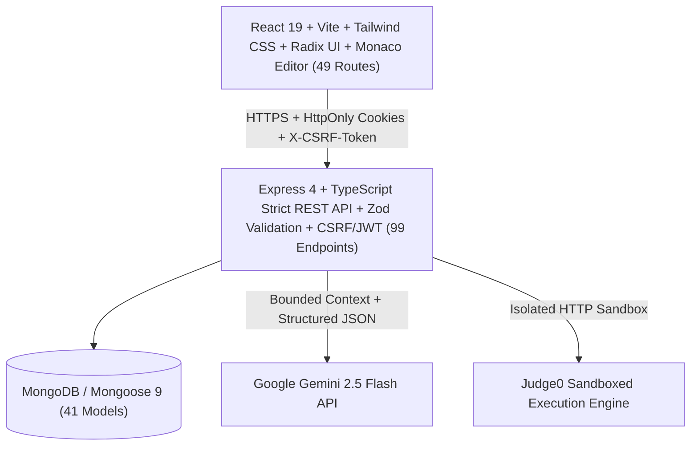

# PrepMind AI — Full-Stack System Architecture

## 1. Architectural Overview
PrepMind AI is a modular, production-grade MERN + TypeScript adaptive placement preparation platform structured across 8 functional domains and 1 hardening/verification layer:

## 2. Subsystem Boundaries
1. **Phase 1 — Identity & Onboarding**: JWT access (`15m`) + rotating refresh tokens (`7d`) in `HttpOnly` cookies (`User`, `Session`), double-submit CSRF cookie (`pm_csrf`), RBAC (`student` / `admin`), and academic profile onboarding.
2. **Phase 2 — Automated Question Bank**: Hierarchical taxonomy (`Category -> Subject -> Topic -> Question`), external DSA problem tracking (`ExternalProblem`, `ExternalProblemProgress`), Gemini AI question generation (`QuestionGenerationJob`), admin review queue, and bulk JSON/CSV import (`QuestionImportBatch`).
3. **Phase 3 — Diagnostic & Timed Assessments**: Server-authoritative timed sessions (`AssessmentTemplate`, `AssessmentSession`, `AssessmentResult`), optimistic concurrency control (`revision`), automatic scoring, and `InitialSkillProfile` generation.
4. **Phase 4 — Bayesian Knowledge Tracing (BKT) & Adaptive Practice**: Probabilistic mastery estimation (`KnowledgeState`, `LearningObservation`, `MasteryHistory`, `AdaptiveSession`, `BKTParameterConfig`) with strict separation from non-objective activities.
5. **Phase 5 — Personalized Learning Roadmaps**: Prerequisite DAG cycle detection (`TopicPrerequisite`), priority-aware topological scheduling (`priorityScoreMap`), daily/weekly task scheduling (`LearningRoadmap`, `RoadmapTask`, `RoadmapMilestone`), spaced revision (`RevisionSchedule`), and dynamic replanning (`RoadmapAdjustmentLog`, `RoadmapConfig`).
6. **Phase 6 — Gemini AI Tutor**: Context-aware conversational tutoring (`TutorConversation`, `TutorMessage`, `TutorUsage`, `TutorAdminConfig`) across 6 pedagogical modes (`explain`, `hint`, `guided`, `solution`, `quiz`, `review`) with daily quotas and spoiler prevention.
7. **Phase 7 — Online Coding Platform**: Integrated `@monaco-editor/react` workspace (`CodingProblem`, `CodingTestCase`, `CodingSubmission`, `CodeDraft`, `CodingProgress`) backed by an isolated `IExecutionProvider` (`Judge0ExecutionProvider`).
8. **Phase 8 — AI Mock Interviews**: Multi-round technical/DSA/HR/behavioral/project/mixed interview engine (`InterviewSession`, `InterviewQuestion`, `InterviewAnswer`, `InterviewEvaluation`, `InterviewReport`) with adaptive follow-up generation and weighted rubric evaluation.
9. **Phase 9 & 9.1 — Unified Readiness Analytics, Security Hardening & E2E Verification**: Cross-pillar Placement Readiness Index (`/analytics` via `readinessIndex.js`), route-based `React.lazy()` code splitting (82.6% entry chunk reduction), NoSQL/Regex sanitization, and 10 Playwright E2E browser test specs.
